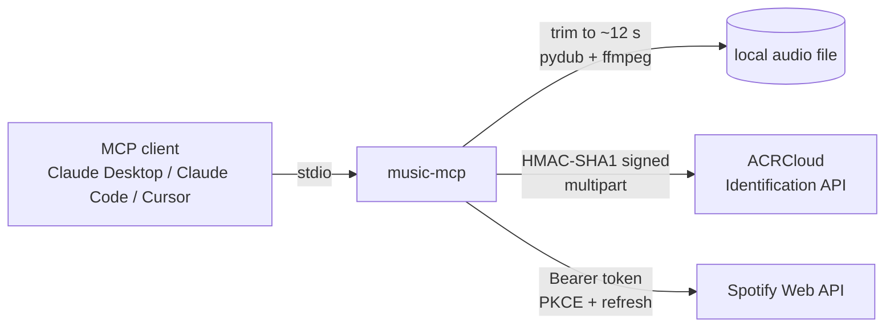

# music-mcp

[](https://github.com/Hoxofp/Music_MCP/actions/workflows/ci.yml)


An [MCP](https://modelcontextprotocol.io) server that lets an AI assistant **identify the song in an
audio file and put it in your Spotify library**: Shazam for your agent.

```text
You:     What's the song in ~/Downloads/party.m4a? Add it to my "Found Sounds" playlist.
Claude:  ▸ identify_song(path="~/Downloads/party.m4a")      → "Midnight City" by M83 (score 98)
         ▸ list_playlists()                                  → "Found Sounds" (id 3cEY…)
         ▸ add_to_playlist(playlist_id="3cEY…", track_ids=["1eyzqe2QqGZUmfcPZtrIyt"])
         Added "Midnight City" by M83 to Found Sounds.
```

## Tools

| Tool | What it does | Hints |
|---|---|---|
| `identify_song` | Fingerprints a ~12 s sample of a local file with ACRCloud; returns the best match + alternatives, with ISRC and Spotify ID when available | read-only |
| `search_tracks` | Spotify catalog search | read-only |
| `save_to_library` | Saves tracks to Liked Songs (accepts IDs, `spotify:track:` URIs or links) | write, idempotent |
| `create_playlist` | Creates a playlist (private by default) | write |
| `add_to_playlist` | Appends tracks to a playlist | write, not idempotent |
| `list_playlists` | Lists the user's playlists | read-only |

Also: a `music://history` resource (songs identified this session) and an `identify_and_save` prompt.
Every tool returns **structured output** with a JSON schema, and failures come back as tool errors
the model can read and recover from (e.g. *"Not logged in to Spotify. Run `music-mcp auth`"*).

## How it works



- **MCP SDK v2** (`MCPServer`), typed lifespan holding a shared `httpx.AsyncClient`.
- **Spotify auth:** Authorization Code + **PKCE**, so no client secret is needed. The token is stored with
  `0600` permissions and refreshed automatically; a `401` triggers one forced refresh and retry, and
  a `429` honours `Retry-After`.
- Uses Spotify's **post-February-2026 endpoints** (`PUT /me/library`, `POST /me/playlists`,
  `POST /playlists/{id}/items`).
- **Sandboxed file access:** set `MUSIC_MCP_AUDIO_DIR` and the model can only read audio inside it.
  Extension and size are validated before anything is read.

## Quick start

```bash
git clone https://github.com/Hoxofp/Music_MCP && cd Music_MCP
uv sync --extra audio          # or: pip install -e ".[audio]"   (needs ffmpeg for exact trimming)
cp .env.example .env           # fill in ACRCloud + Spotify client ID
uv run music-mcp auth          # one-time Spotify login in your browser
```

**Credentials**

1. **ACRCloud:** create an *Audio & Video Recognition* project at <https://console.acrcloud.com>
   and copy host, access key and secret.
2. **Spotify:** create an app at <https://developer.spotify.com/dashboard> and add the redirect URI
   `http://127.0.0.1:8888/callback` (loopback IP, not `localhost`). Only the client ID is required.

**Claude Desktop**: `claude_desktop_config.json`

```json
{
  "mcpServers": {
    "music": {
      "command": "uv",
      "args": ["--directory", "/path/to/Music_MCP", "run", "music-mcp"],
      "env": { "MUSIC_MCP_AUDIO_DIR": "/Users/you/Music" }
    }
  }
}
```

**Claude Code**

```bash
claude mcp add music -- uv --directory /path/to/Music_MCP run music-mcp
```

## Configuration

| Variable | Required | Default |
|---|---|---|
| `ACRCLOUD_HOST`, `ACRCLOUD_ACCESS_KEY`, `ACRCLOUD_ACCESS_SECRET` | for `identify_song` | — |
| `SPOTIFY_CLIENT_ID` | for Spotify tools | — |
| `SPOTIFY_CLIENT_SECRET` | no (enables search before login) | — |
| `SPOTIFY_REDIRECT_URI` | no | `http://127.0.0.1:8888/callback` |
| `MUSIC_MCP_AUDIO_DIR` | no, recommended | unrestricted |
| `MUSIC_MCP_TOKEN_PATH` | no | `~/.config/music-mcp/spotify_token.json` (`%APPDATA%` on Windows) |

## Development

```bash
uv sync --extra audio
uv run pytest            # unit + end-to-end tests over the MCP protocol (in-memory client, mocked HTTP)
uv run ruff check . && uv run ruff format --check .
```

The test suite drives the real server through an in-memory MCP `Client`, with ACRCloud and Spotify
replaced by `httpx.MockTransport`. It covers request signing, token refresh and retry, endpoint
chunking limits, the path sandbox, and error surfacing.

## Changelog

- **2.0.0** — Rewritten as a protocol-native MCP server on the official Python SDK v2 (the 1.x
  prototype was a REST service with MCP-style endpoints, built while learning the protocol).
  PKCE auth, structured outputs, tool annotations, Feb-2026 Spotify API, tests and CI.

## License

MIT © Ahmet Mervan Erman
